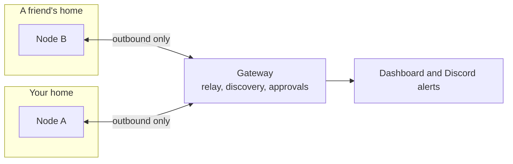

# TinyCloud

A private file cloud for trusted friends. Nodes sync your shared files through a gateway. Nobody controls anyone else's node.

- [Design](docs/design.md)
- [Gateway setup](docs/gateway.md)
- [Run a node](node/README.md)

Nodes only connect out. Files are encrypted before they leave a node, so the gateway relays data it cannot read. More diagrams: [Diagrams](docs/diagrams.md).

Status: working and tested on real hardware, with a dashboard, Discord alerts, weekly gateway backups, optional automatic updates, and linked clouds. There is no website yet. `tools/flash-sd.sh` prepares an SD card for a Pi, then you run the node setup on it.
