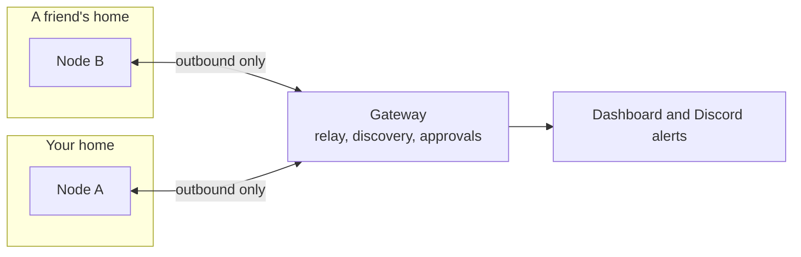
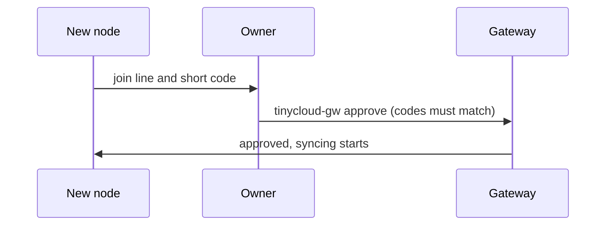
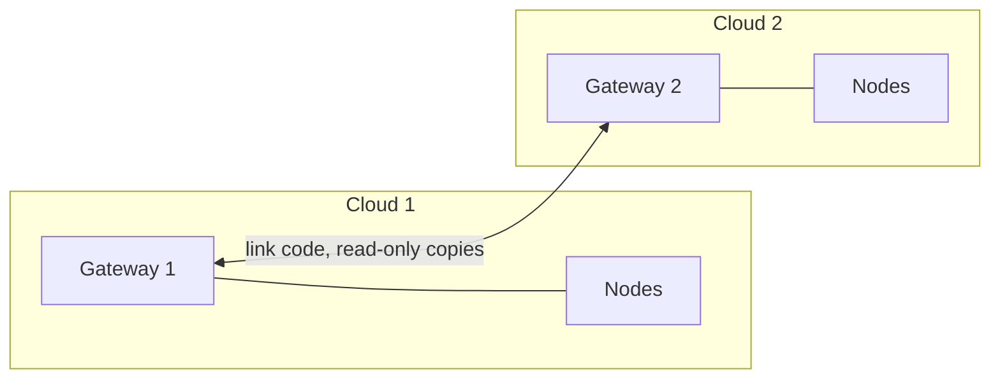

# Diagrams

## How it fits together

Nodes only connect out. Files are encrypted before they leave a node, so the gateway relays data it cannot read.

## Joining

## Two clouds linked

Each person manages only their own gateway, nodes and data. A link gives each side a read-only copy of what the other offers.

